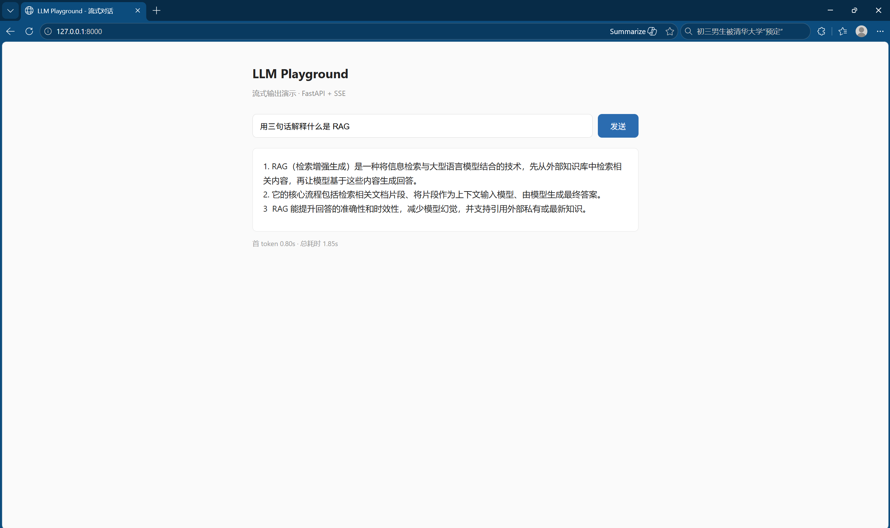

# LLM Playground

学习大模型应用开发的第一批代码：不依赖任何 SDK，直接手写 HTTP 请求调用 `chat/completions`，封装成可复用的模块，并最终提供带流式输出的 HTTP 服务。

## 目录

- `llm_client.py` — 封装的调用模块，提供 `chat()` 和 `ask()`
- `main.py` — FastAPI 服务，提供 `/chat`（一次性）与 `/chat/stream`（SSE 流式）
- `index.html` — 前端页面，打字机效果演示
- `demo1.py` — 封装调用示例
- `streamtest.py` — SSE 流式输出，统计首 token 延迟
- `multiturntest.py` — 多轮对话，维护 messages 历史
- `async_demo.py` — asyncio 并发实验，串行 vs 并发对比
- `practice1.py` — 封装练习版
- `test1.py` — 从零跑通的第一版

## 快速开始

```powershell
python -m venv .venv
.\.venv\Scripts\Activate.ps1
pip install -r requirements.txt

$env:LLM_API_KEY = "sk-..."
```

### 命令行运行

```powershell
python demo1.py
```

### 启动 HTTP 服务

```powershell
uvicorn main:app --reload
```

- 体验流式对话：`http://127.0.0.1:8000/`
- 接口文档：`http://127.0.0.1:8000/docs`

## 接口

| 方法 | 路径 | 说明 |
|---|---|---|
| GET | `/health` | 健康检查 |
| POST | `/chat` | 一次性问答，返回完整答案与 token 用量 |
| POST | `/chat/stream` | 流式问答，逐字返回 |
| GET | `/` | 前端演示页面 |

## 技术要点

- 直接 POST `https://api.deepseek.com/chat/completions`，不依赖 SDK
- `Authorization: Bearer <key>` 认证，响应解析 `choices[0].message.content`
- 流式（客户端）：请求加 `stream: true`，逐行解析 SSE，字段从 `message` 变为 `delta`
- 流式（服务端）：`StreamingResponse` + 生成器，边生成边推给浏览器，配合 `ReadableStream` 实现打字机效果
- 多轮：`messages` 列表按轮次累积 `user` / `assistant`，每轮全量重发
- 并发：`asyncio.gather` 同时发起 10 个请求，实测从 9.43s 降到 1.47s（6.4 倍）
- 服务化：FastAPI + pydantic 定义接口，`/docs` 自动生成交互式文档
- `usage` 含 token 用量，可估算单次调用成本

## 学习进度

- [x] 手写 httpx 调用，跑通协议
- [x] 封装成可复用模块
- [x] SSE 流式输出
- [x] 多轮对话上下文管理
- [x] asyncio 并发调用
- [x] FastAPI 服务化（含流式接口与前端页面）
- [ ] RAG 检索增强生成